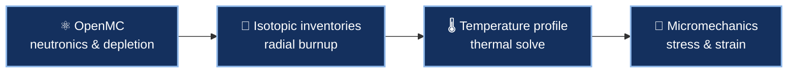

### 🇮🇹 🤝 🇺🇸 Where Italian fuel-performance expertise meets Mines reactor physics

---

## 🤝 About this collaboration

A joint research effort between the **Politecnico di Milano (Milan, Italy)** and the **M-PRISM group at the Colorado School of Mines**. It pairs PoliMI's strength in **nuclear fuel behavior and materials** with Mines' **Monte Carlo neutronics and reactor-physics** capability, then chains them into **multi-physics workflows**: neutronics feeding thermal, mechanical and activation analyses.

| 🏛️ **Politecnico di Milano** | 🏔️ **Colorado School of Mines** |
|:---:|:---:|
| Fuel performance, micromechanics, thermo-mechanical FEA, fusion materials | OpenMC neutronics and depletion, fission-matrix methods, reactor modeling |

---

## 🔬 Research themes

<table>
<tr>
<td width="33%" valign="top">

### 🔥 Fuel performance
How do **solid metallic fission products** (Mo, Ru, Pd, Rh, Tc inclusions) change the mechanical behavior of irradiated UO₂ fuel in a large PWR?

*Neutronics → depletion → thermal → micromechanics.*

</td>
<td width="33%" valign="top">

### ☢️ Fusion blankets
How does **lithium diffusion into alumina coatings** change the neutron activation, and the **waste classification**, of the DEMO WCLL breeding blanket?

*Full-torus OpenMC model + activation analysis.*

</td>
<td width="33%" valign="top">

### 🧱 Research-reactor materials
**Thermo-mechanical FEA** of the spectrum-tailoring buffer zone for a next-generation research reactor, driven by 3-D OpenMC heating and damage fields.

*OpenMC → Abaqus.*

</td>
</tr>
</table>

---

## 🧩 A multi-physics chain

---

## 📦 What's here

| Repository | Description |
|---|---|
| 🧪 [**AP1000-Depletion-Rizzetto**](https://github.com/PoliMI-Mines-Collaboration/AP1000-Depletion-Rizzetto) | OpenMC scripts for the neutronics part of an AP1000 fuel thesis: a single pellet and a full 17×17 assembly, depletion with the CASL PWR chain, and post-processing of keff, actinide and fission-product inventories, radial isotope distributions, flux and reaction-rate maps, and pellet temperature profiles. The README (rewritten 18 Oct 2026) documents every script, the run order and the known open issues. |

> 🔒 This repository is private to the collaboration while the work is in progress.

---

## 📖 Publications from the collaboration

| | Publication |
|---|---|
| 🔥 | *Preliminary multi-physics study of the influence of solid metallic fission products in the UO₂ fuel of the AP1000 reactor*, Rizzetto, Mascolino, Pizzocri, Piccagli & Cefis (2026). An exploratory study: the authors note that the purely elastic model overpredicts stresses and that more advanced constitutive models are needed. |
| ☢️ | *On the Impact of Lithium Diffusion on the Neutron Activation of Alumina Coatings in the DEMO WCLL Breeding Blanket*, Piccinini, Stinchelli, di Fonzo, Mascolino & Cefis, **PHYSOR 2026**, Torino. Lithium-bearing coatings show up to three orders of magnitude higher specific activity at 100 years post-shutdown, and some coatings shift from low-level to intermediate-level waste. |

### 🛠️ In progress

> Active work, not yet published results.

- 🧱 **Buffer-zone thermo-mechanical analysis** for a next-generation research reactor: OpenMC heating and damage fields mapped onto finite-element meshes to study stress, thermal expansion, friction, jamming and low-cycle fatigue (an MS thesis effort across PoliMI, Mines and Virginia Tech).

---

🌐 Part of the [M-PRISM](https://github.com/M-PRISM-Colorado-School-of-Mines) research network

